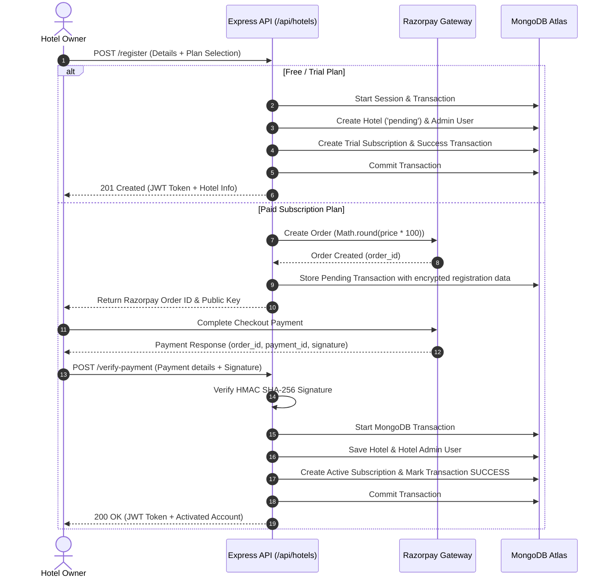
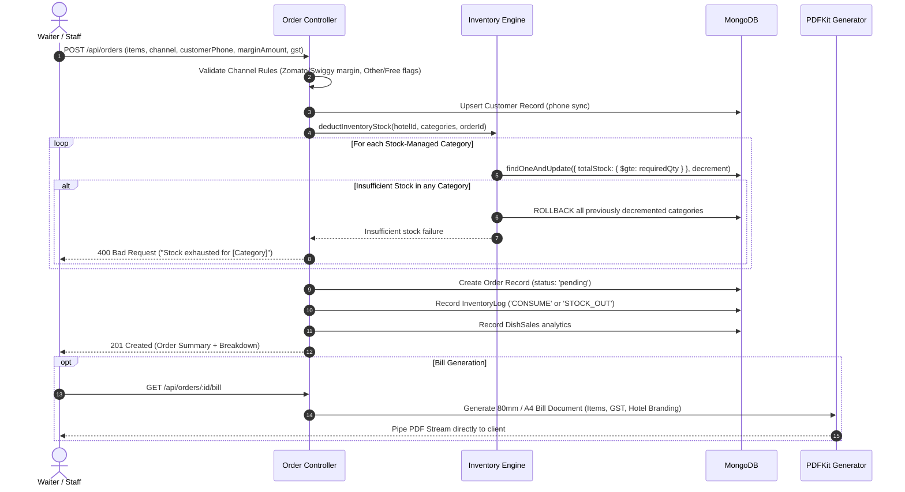
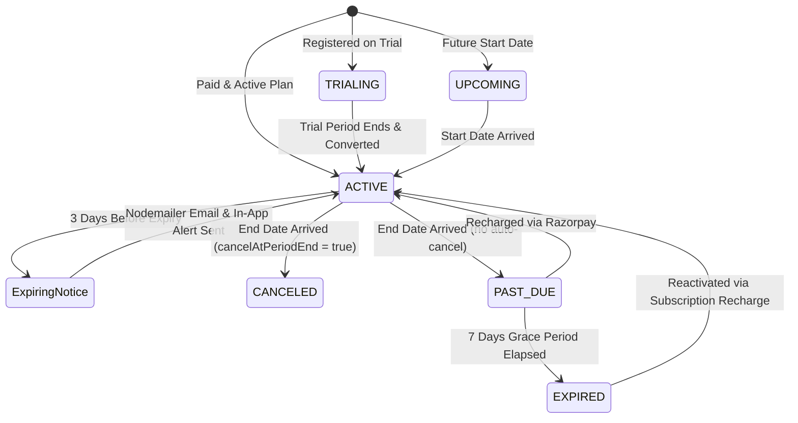

# 🏨 Hotel & Restaurant Management SaaS Platform (Backend)

[](https://nodejs.org/)
[](https://expressjs.com/)
[](https://mongoosejs.com/)
[](https://razorpay.com/)
[](http://localhost:3000/api-docs)

A production-grade, multi-tenant B2B SaaS backend engineered for hotels, restaurants, cafes, and cloud kitchens. It provides an end-to-end management ecosystem covering Point-of-Sale (POS) order billing, multi-channel sales (Dine-in, Takeaway, Swiggy, Zomato), atomic inventory tracking per plate, automated subscription billing with Razorpay, staff management, audit logging, and automated expiry lifecycle crons.

---

## 📑 Table of Contents

- [Overview & Value Proposition](#-overview--value-proposition)
- [Target Personas & Who Can Use It](#-target-personas--who-can-use-it)
- [System Architecture & Core Flows](#-system-architecture--core-flows)
  - [1. Hotel Registration & Subscription Payment Flow](#1-hotel-registration--subscription-payment-flow)
  - [2. Multi-Channel POS Order & Atomic Inventory Flow](#2-multi-channel-pos-order--atomic-inventory-flow)
  - [3. Subscription Lifecycle & Automated Cron Flow](#3-subscription-lifecycle--automated-cron-flow)
  - [4. Role-Based Access Control & Feature Gating](#4-role-based-access-control--feature-gating)
- [Key Features & Capabilities](#-key-features--capabilities)
- [Technology Stack](#-technology-stack)
- [Project Directory Structure](#-project-directory-structure)
- [Getting Started & Installation](#-getting-started--installation)
  - [Prerequisites](#prerequisites)
  - [Environment Setup](#environment-setup)
  - [Database Seeding](#database-seeding)
  - [Running the Server](#running-the-server)
- [API Documentation & Postman](#-api-documentation--postman)
- [API Endpoints Reference](#-api-endpoints-reference)
- [Security & Architecture Highlights](#-security--architecture-highlights)
- [Troubleshooting & FAQs](#-troubleshooting--faqs)

---

## 🌟 Overview & Value Proposition

Modern hospitality businesses face challenges tracking food stock per dish sold, reconciling aggregator orders (Zomato/Swiggy), handling waiter commissions/orders, and managing recurring software subscription billing.

This project delivers a multi-tenant backend architecture where:
- **Tenancy Isolation:** Each hotel operates in a logically isolated silo with dedicated dishes, categories, staff, inventory records, and financial analytics.
- **SaaS Monetization Engine:** Built-in plan creation (Trial, Monthly, Yearly), checkout with Razorpay, payment verification via cryptographic HMAC signatures, and automated renewal/grace-period enforcement.
- **Zero-Overselling Inventory:** Real-time atomic inventory deduction on order placement with rollback safeguards on stock shortage.
- **Instant Billing:** Server-side PDF invoice generation using `pdfkit`.

---

## 👥 Target Personas & Who Can Use It

| Persona | Role Key | What They Do In The Platform |
| :--- | :--- | :--- |
| **Platform Super Admin** | `SUPER_ADMIN` | • Oversees the entire SaaS platform.<br>• Approves or suspends hotel registrations.<br>• Manages global subscription plans and pricing tiers.<br>• Views cross-platform metrics, revenue stats, and audit logs.<br>• Broadcasts system announcements and updates platform settings.<br>• Capable of performing nuclear data wipe for decommissioned hotels. |
| **Hotel / Restaurant Owner** | `HOTEL_ADMIN` | • Self-registers their business and chooses a trial or paid plan.<br>• Manages their menu catalog (Categories & Dishes), with Excel bulk upload support.<br>• Configures category-level stock management and restocks items.<br>• Onboards and manages staff (waiters, cashiers, kitchen staff).<br>• Monitors hotel analytics, dish sales trends, order reports, and customer lists.<br>• Manages Razorpay plan recharges and invoices. |
| **Staff Member** (Waiters, Cashiers) | `STAFF` | • Logs in via the dedicated staff login portal (`/api/auth/staff-login`).<br>• Takes orders across Dine-In, Takeaway, Swiggy, Zomato, and Other channels.<br>• Transitions order statuses (`pending` ➔ `preparing` ➔ `ready` ➔ `delivered` ➔ `paid`/`billed`).<br>• Generates and downloads customer PDF receipts.<br>• Reviews personal order history and sales performance on the staff dashboard. |
| **Customer / Guest** | `CUSTOMER` | • Automatically created or synced upon phone-number entry during order creation.<br>• Has an isolated record linked to the hotel.<br>• Enables hotel admins to track repeat customer lifetime metrics. |

---

## 🔄 System Architecture & Core Flows

### 1. Hotel Registration & Subscription Payment Flow



---

### 2. Multi-Channel POS Order & Atomic Inventory Flow



---

### 3. Subscription Lifecycle & Automated Cron Flow

The background worker runs daily at midnight (`0 0 * * *`) via `node-cron` in `scripts/subscriptionCron.js`:



---

### 4. Role-Based Access Control & Feature Gating

Requests pass through a multi-tier middleware chain:

1. **`authenticate` (`middleware/auth.js`)**:
   - Validates Bearer JWT.
   - Rejects blacklisted tokens (`TokenBlacklist`).
   - Verifies whether the associated Hotel is `active` (rejects `pending` or `suspended` hotels in real-time).
2. **`allowRoles(...roles)` (`middleware/allowedRoles.js`)**:
   - Ensures the caller belongs to permitted roles (`SUPER_ADMIN`, `HOTEL_ADMIN`, `STAFF`, `CUSTOMER`).
3. **`requireFeature(featureKey)` (`middleware/requireFeature.js`)**:
   - Inspects the Hotel's current active subscription plan features (`Plan.features`).
   - Features include: `POS_SYSTEM`, `SALES_ANALYTICS`, `BULK_MENU_UPLOAD`, `STAFF_MANAGEMENT`, `ORDER_MANAGEMENT`, `ADVANCED_REPORTS`.
4. **`checkLimit(limitKey, countResolver)` (`middleware/checkLimit.js`)**:
   - Restricts resource counts according to plan quotas (e.g., `maxStaff`, `maxDishes`, `maxCategories`).

---

## ⚡ Key Features & Capabilities

- **Multi-Tenant Isolation:** Complete data separation by Hotel ID across all operational and analytical queries.
- **Omnichannel POS Billing:**
  - Channels supported: `dine-in`, `takeaway`, `zomato`, `swiggy`, `other`.
  - Channel margins and free plate tracking (`isFree`).
  - Automated GST computation (`subTotal`, `gstTotal`, `grandTotal`).
  - Printable PDF receipts generated on the fly.
- **Atomic Stock Management:**
  - Category-based plate stock allocation.
  - Concurrency-safe atomic `$inc` with `$gte` queries preventing negative inventory.
  - Automatic rollback on partial allocation failure.
  - Complete inventory change log (`InventoryLog`) supporting stock adjustments (`ADD`, `SET`, `CONSUME`, `STOCK_OUT`).
- **Menu & Catalog Control:**
  - Unlimited categories and dishes with toggleable availability (`isAvailable`).
  - Excel bulk menu import using `xlsx` and `multer`.
- **Razorpay Subscription Engine:**
  - Plan creation with custom trial days and billing cycles (`MONTHLY`, `YEARLY`, `QUARTERLY`, `HALF_YEARLY`).
  - Webhook-grade cryptographic payment verification (`crypto` HMAC SHA-256).
  - Recharges, plan upgrades, and transaction history.
- **Staff Performance Portal:**
  - Dedicated authentication for staff members.
  - Real-time staff personal dashboard tracking assigned orders and revenue generated.
  - Safety delete locks preventing staff deletion if active or historical orders are linked.
- **Audit Trails & Notifications:**
  - Platform-wide audit logging (`AuditLog`) for admin activities.
  - Targeted announcement system (`ALL`, `HOTEL_ONLY`, `STAFF_ONLY`, `SPECIFIC_HOTEL`).
  - Automated transactional emails using Nodemailer with HTML templates.
- **Swagger Documentation:** Built-in interactive API playground served at `/api-docs`.

---

## 🛠️ Technology Stack

| Component | Library / Framework | Version | Purpose |
| :--- | :--- | :--- | :--- |
| **Runtime** | Node.js | >= 18.0.0 | JavaScript runtime |
| **Framework** | Express.js | 4.21.0 | REST API routing and middleware pipeline |
| **Database** | MongoDB & Mongoose | 8.7.0 | Schemas, relations, indexes, transactions |
| **Authentication** | JSON Web Tokens (`jsonwebtoken`) | 9.0.2 | Stateless Bearer token authorization |
| **Password Hashing**| `bcrypt` / `bcryptjs` | 6.0.0 | Secure one-way credential encryption |
| **Payments** | Razorpay SDK | 2.9.6 | Order generation & checkout verification |
| **Invoicing** | PDFKit | 0.15.0 | Dynamic PDF bill and receipt generation |
| **Spreadsheets** | SheetJS (`xlsx`) & Multer | 0.18.5 | Memory-buffered Excel bulk menu ingestion |
| **Scheduler** | `node-cron` | 4.2.1 | Midnight subscription auditing & reminders |
| **Mailing** | Nodemailer | 8.0.4 | Expiry warnings and platform email alerts |
| **API Docs** | Swagger UI Express & `swagger-jsdoc` | 5.0.1 | Interactive OpenAPI documentation |

---

## 📂 Project Directory Structure

```text
hotel_backend-main/
├── config/
│   ├── db.js                     # MongoDB connection bootstrap
│   ├── razorpay.js               # Razorpay client instance
│   └── swagger.js                # OpenAPI / Swagger definition
├── controllers/
│   ├── AdminRoutes.js            # Platform user/setting/log controllers
│   ├── AuditLogController.js     # System audit trail queries
│   ├── authController.js         # Register, Login, Staff-Login, Logout
│   ├── BookingsController.js     # Room bookings (optional module)
│   ├── category.controller.js    # Dish category management
│   ├── dish.controller.js        # Menu dishes & Excel bulk upload
│   ├── dishSalesController.js    # Live dish sales aggregation
│   ├── HotelController.js        # Hotel lifecycle, dashboards, onboarding
│   ├── InventoryController.js    # Stock adjustment, logs, and overview
│   ├── NotificationController.js # Broadcast & hotel-targeted notifications
│   ├── orderController.js        # POS order creation, stock deduction, PDF bills
│   ├── planController.js         # Subscription plan definitions & pricing
│   ├── ProfileController.js      # User profile viewing & edits
│   ├── ReceiptController.js      # Booking receipts
│   ├── RoomController.js         # Room management (optional module)
│   ├── SettingController.js      # Platform key-value settings
│   ├── StaffController.js        # Staff management & staff dashboard
│   ├── subscriptionController.js # Razorpay order creation, recharges, history
│   └── UserController.js         # Platform user administration
├── middleware/
│   ├── allowedRoles.js           # Role authorization guard
│   ├── auth.js                   # JWT verification, blacklist & hotel status check
│   ├── checkLimit.js             # Plan resource limiter
│   ├── requireFeature.js         # Plan feature flag gatekeeper
│   └── role.js                   # Secondary role checker
├── models/
│   ├── AuditLog.js               # Audit records for actions
│   ├── Category.js               # Menu categories
│   ├── CategoryInventory.js      # Stock per category per hotel
│   ├── Customer.js               # Guest snapshot records
│   ├── Dish.js                   # Menu dish items
│   ├── DishSales.js              # Aggregated dish order metrics
│   ├── Hotel.js                  # Multi-tenant Hotel entity
│   ├── InventoryLog.js           # In/Out stock audit log
│   ├── Notification.js           # In-app notification messages
│   ├── orderItem.js              # Orders & order lines
│   ├── Plan.js                   # Subscription tiers & features
│   ├── Setting.js                # Platform configuration
│   ├── Subscription.js           # Hotel active & historical subscriptions
│   ├── TokenBlacklist.js         # Invalidated JWTs on logout
│   ├── Transaction.js            # Razorpay payments ledger
│   ├── Usage.js                  # Resource usage tracking
│   └── User.js                   # System users (All roles)
├── routes/                       # Express route mappings
├── scripts/
│   ├── seed-super-admin.js       # Seed initial Super Admin account
│   ├── seed-plans.js             # Seed standard Trial and Working plans
│   ├── seed-test-notifications.js# Seed sample announcements
│   ├── subscriptionCron.js       # Scheduled subscription audit runner
│   └── test-cron.js              # Standalone test runner for cron
├── utils/
│   ├── AppError.js               # Custom error wrapper
│   ├── constants.js              # ROLES, FEATURES, SUBSCRIPTION_STATUS
│   ├── emailService.js           # Nodemailer transport & HTML mailers
│   ├── logger.js                 # Audit logger helper
│   ├── pagination.js             # Reusable pagination calculator
│   ├── queryFilter.js            # Reusable query string builder
│   └── subscription.js           # Date calculation helpers
├── bulkupload.csv                # Example CSV format for dish uploads
├── app.js                        # Express app initialization, CORS, global error handler
├── server.js                     # HTTP server startup & cron scheduling
├── package.json
└── README.md
```

---

## 🚀 Getting Started & Installation

### Prerequisites

Ensure you have the following installed on your machine:
- [Node.js](https://nodejs.org/) (v18.x or later)
- [npm](https://www.npmjs.com/) (v9.x or later)
- [MongoDB](https://www.mongodb.com/) (Local Community Server or MongoDB Atlas instance)

---

### Environment Setup

1. Clone or navigate to the project directory:
   ```bash
   cd hotel_backend-main
   ```

2. Install dependencies:
   ```bash
   npm install
   ```

3. Create a `.env` file from `.env.example`:
   ```bash
   cp .env.example .env
   ```

4. Populate the `.env` variables:
   ```ini
   PORT=3000
   NODE_ENV=development
   MONGO_URI=mongodb://127.0.0.1:27017/hotel_management
   JWT_SECRET=your_super_secret_jwt_key_here
   
   # Super Admin Master Override
   ADMIN_PHONE=1234567890
   ADMIN_PASSWORD=your_super_admin_secure_password
   
   # Razorpay Gateway
   RAZORPAY_KEY_ID=rzp_test_your_razorpay_key_id
   RAZORPAY_KEY_SECRET=your_razorpay_key_secret
   
   # SMTP Email Configuration
   EMAIL_HOST=smtp.gmail.com
   EMAIL_PORT=587
   EMAIL_USER=your_email@gmail.com
   EMAIL_PASS=your_gmail_app_password
   APP_URL=http://localhost:3000
   ```

---

### Database Seeding

Before using the application, run the database seed scripts to create essential plans and a Super Admin:

1. **Seed Super Admin:**
   ```bash
   node scripts/seed-super-admin.js
   ```
   *Default Seed Credentials:*
   - **Phone:** `1234567890`
   - **Password:** `123456`
   - **Role:** `SUPER_ADMIN`

2. **Seed Subscription Plans:**
   ```bash
   node scripts/seed-plans.js
   ```
   *Creates:*
   - **Trial Plan:** 30 days free access, price `0`, billingCycle: `NONE`.
   - **Whole Working Plan:** Complete system access, price `999 INR/month`.

---

### Running the Server

#### Development Mode (with hot-reload via Nodemon):
```bash
npm run dev
```

#### Production Mode:
```bash
npm start
```

Once running, you should see:
```text
Server running on port 3000
MongoDB Connected: 127.0.0.1
[CRON] Subscription expiry cron job scheduled (daily at midnight).
```

---

## 📖 API Documentation & Postman

### Interactive Swagger UI
The backend provides interactive Swagger documentation. Once the server is running, open:
👉 **[http://localhost:3000/api-docs](http://localhost:3000/api-docs)**

You can test endpoints, inspect schemas, and authenticate directly using the **Authorize** button with your JWT token.

### Postman Collections
Two pre-configured Postman collections are included in the root directory:
1. `HotelManagement.postman_collection.json`: Complete collection for Admin, Super Admin, POS, and Subscription operations.
2. `staff-app.postman_collection.json`: Dedicated collection tailored for mobile and web staff POS workflows.

*Import either JSON file directly into Postman to start testing immediately.*

---

## 📡 API Endpoints Reference

### 🔐 Authentication (`/api/auth`)
| Method | Endpoint | Access | Description |
| :--- | :--- | :--- | :--- |
| `POST` | `/api/auth/register` | Public | Register standard user or hotel admin (requires `X-Setup-Key` for admin roles) |
| `POST` | `/api/auth/login` | Public | Login with phone & password (returns token & subscription status) |
| `POST` | `/api/auth/staff-login`| Public | Dedicated staff authentication endpoint |
| `POST` | `/api/auth/logout` | Authenticated | Invalidate token and append to `TokenBlacklist` |

### 🏨 Hotels & Onboarding (`/api/hotels`)
| Method | Endpoint | Access | Description |
| :--- | :--- | :--- | :--- |
| `POST` | `/api/hotels/register` | Public | Self-registration for hotels (free trial or returns Razorpay order) |
| `POST` | `/api/hotels/verify-payment` | Public | Verify Razorpay signature and activate registered hotel |
| `GET` | `/api/hotels` | Super Admin / Hotel Admin | List all hotels |
| `GET` | `/api/hotels/:id` | Authenticated | Get hotel details |
| `GET` | `/api/hotels/:id/dashboard`| Super / Hotel Admin | Detailed metrics, revenue, staff, orders, and inventory |
| `GET` | `/api/hotels/super/dashboard`| Super Admin | Global platform overview and cross-hotel analytics |
| `PATCH`| `/api/hotels/:id/approve` | Super Admin | Approve pending hotel registration and optionally assign plan |
| `DELETE`| `/api/hotels/:id` | Super Admin | Nuclear cascade wipe of hotel and all associated records |
| `GET` | `/api/hotels/customers` | Hotel Admin / Staff | List registered customers for the current hotel |

### 💳 Plans & Subscriptions (`/api/plans` & `/api/subscription`)
| Method | Endpoint | Access | Description |
| :--- | :--- | :--- | :--- |
| `GET` | `/api/plans` | Public | View active subscription plans for pricing pages |
| `POST` | `/api/plans/admin` | Super Admin | Create a new subscription plan tier |
| `PUT` | `/api/plans/admin/:id`| Super Admin | Update plan pricing, features, or billing cycle |
| `DELETE`| `/api/plans/admin/:id`| Super Admin | Archive/deactivate a plan |
| `POST` | `/api/subscription/create-order` | Authenticated | Create a Razorpay order for plan purchase or recharge |
| `POST` | `/api/subscription/verify-payment`| Public / Auth | Verify Razorpay signature and activate subscription |
| `GET` | `/api/subscription` | Hotel Admin | View current hotel subscription status and days remaining |
| `POST` | `/api/subscription/cancel` | Hotel Admin | Cancel subscription (effective immediately or period end) |
| `GET` | `/api/subscription/transactions`| Hotel Admin | View payment and transaction history |
| `GET` | `/api/subscription/admin/all` | Super Admin | View subscriptions across all hotels |

### 🍽️ Dishes & Menu Management (`/api/dish` & `/api/category`)
| Method | Endpoint | Access | Description |
| :--- | :--- | :--- | :--- |
| `POST` | `/api/category` | Admin / Staff | Create a food category (enforces `maxCategories` limit) |
| `GET` | `/api/category` | Authenticated | List categories for current hotel |
| `PUT` | `/api/category/update/:id` | Admin / Staff | Update category name or `StockManagement` toggle |
| `DELETE`| `/api/category/delete/:id` | Admin / Staff | Delete category |
| `POST` | `/api/dish` | Admin / Staff | Create a menu dish (enforces `maxDishes` limit) |
| `POST` | `/api/dish/bulk-upload` | Admin / Staff | Bulk upload dishes via Excel file (`.xlsx`, `.xls`) |
| `GET` | `/api/dish` | Authenticated | List all dishes for current hotel |
| `GET` | `/api/dish/category/:categoryId`| Authenticated | Filter dishes by category |
| `PUT` | `/api/dish/:id` | Admin / Staff | Update dish price, name, or availability |
| `DELETE`| `/api/dish/:id` | Admin / Staff | Delete a dish |

### 📦 POS Orders & Invoicing (`/api/orders`)
| Method | Endpoint | Access | Description |
| :--- | :--- | :--- | :--- |
| `POST` | `/api/orders` | Admin / Staff | Create new order (triggers atomic inventory deduction) |
| `GET` | `/api/orders` | Authenticated | List orders with pagination and date filtering |
| `GET` | `/api/orders/:id` | Authenticated | Get full details of a specific order |
| `PATCH`| `/api/orders/:id/status`| Admin / Staff | Update status (`pending`, `preparing`, `ready`, `delivered`, `paid`, `billed`)|
| `GET` | `/api/orders/:id/bill` | Admin / Staff | Generate & stream PDF receipt for an order |
| `PUT` | `/api/orders/update/:orderId`| Authenticated | Edit order details |
| `DELETE`| `/api/orders/:id` | Authenticated | Cancel order |

### 📊 Inventory & Stock Control (`/api/inventory`)
| Method | Endpoint | Access | Description |
| :--- | :--- | :--- | :--- |
| `GET` | `/api/inventory` | Admin / Staff / Super | Category stock stats (`totalStock`, `totalConsumed`, `totalAdded`)|
| `GET` | `/api/inventory/logs` | Hotel Admin / Super | Audit trail of all stock additions, deductions, and orders |
| `GET` | `/api/inventory/overview` | Admin / Staff / Super | Combined view of inventory statistics and recent logs |
| `POST` | `/api/inventory/add` | Hotel Admin / Super | Replenish/add stock to a category |
| `POST` | `/api/inventory/adjust` | Hotel Admin / Super | Manually correct/adjust current stock with reason log |

### 👨‍🍳 Staff Operations (`/api/staff`)
| Method | Endpoint | Access | Description |
| :--- | :--- | :--- | :--- |
| `POST` | `/api/staff` | Super / Hotel Admin | Create staff account (gated by `maxStaff` limit) |
| `GET` | `/api/staff/dashboard` | Staff | Personal dashboard (my orders, revenue handled, metrics) |
| `GET` | `/api/staff/orders` | Staff | List orders handled by the logged-in staff member |
| `GET` | `/api/staff/hotel/:hotelId`| Super / Hotel Admin | List all staff members for a hotel |
| `PUT` | `/api/staff/:id` | Super / Admin / Self | Update staff profile details |
| `DELETE`| `/api/staff/:id` | Super / Hotel Admin | Delete staff (blocked if staff has active orders) |

### ⚙️ Super Admin Platform Settings & Audit (`/api/admin`)
| Method | Endpoint | Access | Description |
| :--- | :--- | :--- | :--- |
| `GET` | `/api/admin/users` | Super Admin | View all platform users with pagination |
| `PATCH`| `/api/admin/users/:id/toggle-status`| Super Admin | Block or unblock a user |
| `GET` | `/api/admin/settings` | Super Admin | View global platform key-value settings |
| `POST` | `/api/admin/settings` | Super Admin | Upsert platform setting |
| `GET` | `/api/admin/logs` | Super Admin | Inspect full system audit log |
| `POST` | `/api/admin/notifications` | Super Admin | Broadcast global or targeted in-app announcement |

---

## 🔒 Security & Architecture Highlights

1. **HMAC SHA-256 Payment Verification:** Razorpay webhook and checkout responses are cryptographically verified using `crypto.createHmac('sha256', secret)` before any account or subscription is granted.
2. **ACID Transactions:** Hotel onboarding and registration payment verifications execute inside MongoDB session transactions (`mongoose.startSession()`). If any operation fails, the entire transaction aborts to prevent orphaned records.
3. **Atomic Stock Decrements:** Race conditions during high-volume POS ordering are avoided using atomic MongoDB `$gte` updates on `CategoryInventory`.
4. **Token Blacklisting & Clear-Site-Data:** Explicit logout operations push JWT signatures to a TTL-indexed `TokenBlacklist` collection and emit `Clear-Site-Data` response headers to wipe browser caches and client tokens.
5. **Real-time Status Enforcement:** In addition to verifying JWT tokens, the authentication middleware verifies in real time that the user's parent hotel is `active`. If a Super Admin suspends a hotel, all its admin and staff accounts immediately lose access without waiting for tokens to expire.

---

## ❓ Troubleshooting & FAQs

### Q: Why do I get `"Your hotel is pending approval"` on login?
**A:** Newly self-registered hotels default to `status: 'pending'`. The Super Admin must approve the hotel via `PATCH /api/hotels/:id/approve` or assign an active subscription plan before staff or admins can perform business operations.

### Q: How do I create my first Super Admin?
**A:** Run `node scripts/seed-super-admin.js`. Alternatively, make a `POST /api/auth/register` request with header `X-Setup-Key: <ADMIN_PASSWORD>`.

### Q: Why does order creation fail with `"Stock exhausted"`?
**A:** If dishes belong to a category that has `StockManagement: true`, stock must be added first via `POST /api/inventory/add` before orders can be placed for those items.

### Q: Can staff members delete other staff members?
**A:** No. Only `HOTEL_ADMIN` and `SUPER_ADMIN` have privileges to create or remove staff accounts. Furthermore, staff members cannot be deleted if active orders (`pending`, `preparing`, `ready`) are assigned to them.

---

## 📄 License
This project is proprietary and licensed under the MIT License.
